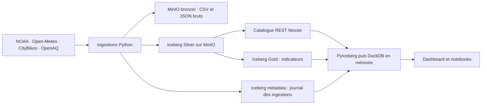

# UrbanHub : data lake urbain MinIO

Projet de module **Data Lake**, alimenté par trois flux : batch météo NOAA/Open-Meteo, streaming CityBikes et IoT OpenAQ.

**Apache Iceberg v2 organise maintenant les tables Silver, Gold et le journal d'ingestion.** MinIO conserve leurs fichiers et les sources Bronze. Le catalogue REST **Nessie** utilise un volume RocksDB persistant pour les références des tables, sans PostgreSQL. PyIceberg écrit et lit les snapshots ; DuckDB exécute les requêtes du dashboard en mémoire.



## Démarrer

Prérequis : Docker Desktop et une clé OpenAQ pour la pollution. Les flux météo et vélos ne demandent pas cette clé.

Si `.env` n'existe pas, copier `.env.example` vers `.env`, puis renseigner les identifiants MinIO et `OPENAQ_API_KEY`. Les identifiants `S3_ACCESS_KEY_ID` / `S3_SECRET_ACCESS_KEY` doivent correspondre à `MINIO_ROOT_USER` / `MINIO_ROOT_PASSWORD` pour les scripts hors Docker. Compose les configure automatiquement pour ses services.

```bash
docker compose up -d --build minio minio-init nessie
docker compose --profile all up -d --build
docker compose --profile batch run --rm batch-meteo
docker compose --profile streaming run --rm streaming-velib --once
docker compose --profile streaming run --rm streaming-velib --analyze --days 2
docker compose --profile analysis run --rm lake-gold
```

MinIO est construit depuis le tag officiel RELEASE.2025-10-15T17-29-55Z dans `docker/minio.Dockerfile` ; le premier build compile le serveur Go. Les services attendent la création du bucket. MinIO conserve ses objets dans le volume Docker `minio-data`, avec versioning activé. La première exécution du batch NOAA télécharge plusieurs Go et peut prendre du temps.

| Interface | Adresse |
|---|---|
| MinIO console | http://localhost:9001 ; identifiants dans `.env` |
| MinIO API S3 depuis Windows | http://localhost:9002 |
| MinIO API S3 entre conteneurs | http://minio:9000 |
| Catalogue Nessie REST | http://localhost:19120/iceberg |
| Dashboard et inspection Iceberg | http://localhost:8501 |
| Jupyter, profil `notebook` | http://localhost:8888 |

## Vérifier et analyser

```bash
docker compose run --rm minio-init python -m urbanhub_common check
docker compose --profile streaming run --rm streaming-velib --check-s3
docker compose --profile analysis run --rm lake-gold python -m urbanhub_common gold --start 2026-10-01 --end 2026-10-24
docker compose --profile analysis run --rm cross-analysis archive --months 202609
```

La fenêtre Gold est UTC, début inclus et fin exclue. Le croisement joint les flux par ville et heure. Les données absentes restent nulles. NOAA reste prioritaire sur Open-Meteo ; les polluants et unités ne sont pas mélangés. Les snapshots vélos mesurent un stock, les archives permettent d'estimer retraits et retours.

Les noms comme `meteo.daily`, `pollution.v_city_levels` et `analytics.v_city_hourly_all` sont des vues DuckDB en mémoire, reconstruites depuis les snapshots Iceberg. Les ingestions archivent les sources dans MinIO Bronze et publient les tables Silver/Gold via le catalogue Nessie. Les capteurs et curseurs de reprise sont relus depuis Silver ; les états des exécutions viennent de `metadata.ingestion_runs`.

## Organisation

| Dossier | Rôle |
|---|---|
| `shared/urbanhub_common/` | stockage Bronze, tables Iceberg, références, journal, requêtes DuckDB, calcul Gold |
| `part1_batch_meteo/` | téléchargement NOAA et météo Open-Meteo |
| `part2_streaming_velib/` | polling CityBikes toutes les 3 min et analyses Q1–Q5 |
| `part3_iot_pollution/` | capteurs, backfill et polling OpenAQ |
| `part4_analyse_croisee/` | archives mensuelles CityBikes |
| `dashboard/`, `notebooks/` | restitution depuis les snapshots Iceberg |

[Architecture du data lake](docs/ARCHITECTURE_ICEBERG.md)

## Tests

```bash
python -m pip install -r requirements-dev.txt
python -m pytest -q
```

Les tests utilisent Moto pour les anciennes lectures S3, un catalogue Iceberg local pour les opérations de tables et le vrai moteur DuckDB pour les requêtes. Les scans Iceberg filtrent les partitions temporelles ; les résultats sont ensuite chargés en mémoire pour les analyses du TP. Les upserts remplacent les observations de même clé métier. Les compteurs d'ingestion indiquent les lignes soumises, pas le nombre de nouvelles clés uniques.

## Tables Apache Iceberg

L'onglet **Data Lake Iceberg** montre les tables du catalogue, leur format v2, le snapshot courant, le schéma et les partitions. Les tables sont dans `s3://urbanhub/iceberg/<zone>/...` : Parquet de données, manifestes Avro et métadonnées JSON. Les anciens fichiers restent conservés comme sources de migration et ne sont plus scannés par les lectures normales.

```bash
docker compose run --rm minio-init python -m urbanhub_common.iceberg migrate
docker compose run --rm minio-init python -m urbanhub_common.iceberg list
```

La migration lit les anciens Parquet, déduplique les clés métier, écrit les tables et vérifie les comptes. Elle préserve les tables Iceberg qui possèdent déjà un snapshot. Arrêter les trois collectes avant une migration initiale pour obtenir un état cohérent. Les nouvelles écritures utilisent des upserts et des commits Iceberg avec reprise des conflits optimistes ; les tables sont partitionnées par jour UTC. Les ajouts de colonnes sont pris en charge. Bronze et les exports CSV/PNG restent des objets ordinaires.

Le catalogue est persistant dans `nessie-data` ; sauvegarder ce volume avec les objets MinIO. Aucun nettoyage de snapshots ou de fichiers orphelins n'est exécuté automatiquement. Les snapshots/versions conservées sont lisibles via leur fichier Iceberg `.metadata.json` committé. Le mode Parquet historique est réservé à la migration et aux tests de régression (`LAKE_TABLE_FORMAT=parquet`) ; le fonctionnement normal impose `iceberg`.

Détails : [architecture Iceberg](docs/ARCHITECTURE_ICEBERG.md).

## Remise et reproductibilité

Le rendu contient les sources, notebooks, tests, Dockerfiles et la configuration d'exemple. Créer `.env` à partir de `.env.example` et renseigner la clé OpenAQ avant de lancer Docker Compose. Le fichier `.env`, les caches, téléchargements et volumes Docker ne doivent pas être inclus dans le rendu.

Les données ne sont pas embarquées dans les sources : les ingestions les reconstruisent depuis les API et archives publiques. Pour un premier essai, démarrer le profil `all`, attendre une collecte puis ouvrir le dashboard. Le batch NOAA et les archives mensuelles sont des imports explicites ; leurs commandes sont indiquées ci-dessus et dans les README des modules. Sans clé OpenAQ valide, le flux pollution ne peut pas se charger.

Les notebooks sont fournis sans sorties enregistrées. Les exécuter avec Jupyter après avoir alimenté le lake. Les volumes `minio-data` et `nessie-data` conservent les données entre redémarrages ; `docker compose down` arrête le projet sans effacer ces volumes.
